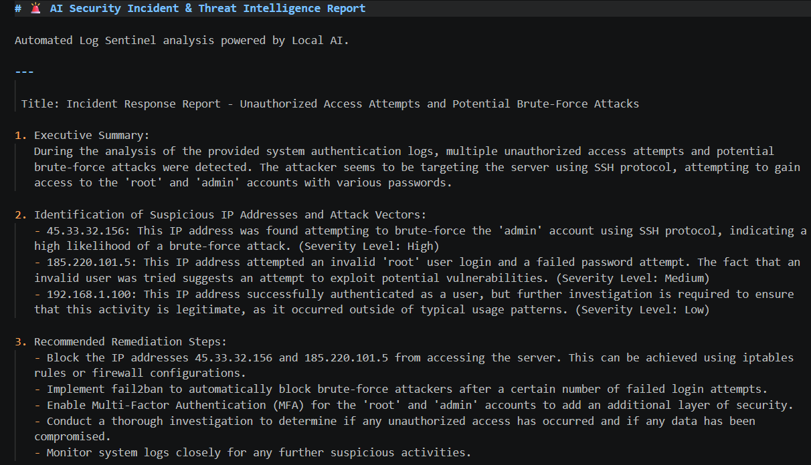

# 🛡️ AI-Powered Local Log Sentinel (SOC Analyst & Threat Intel)

A lightweight and automated **Security Information and Event Management (SIEM) / Log Analysis Tool**, powered by a Local Language Model (**Ollama + Mistral**). Designed to parse authentication system logs, detect suspicious activities (such as SSH brute-force attacks and unauthorized access), and generate professional incident response reports while ensuring **absolute data privacy** (100% offline).

## 🚀 Key Features
- **Automated Log Parsing:** Reads and processes system log files (e.g., \`sample_auth.log\`) to look for security anomalies.
- **AI Threat Intelligence:** Acts as an expert SOC (Security Operations Center) Analyst, classifying threats and determining severity levels.
- **Actionable Remediation:** Generates security incident reports (\`incident_report.md\`) with recommended mitigation steps and firewall rules (\`iptables\` / \`fail2ban\`).
- **Interactive Terminal UI:** Clean and structured console rendering using the \`rich\` library.

## 🛠️ Built With
- **Python 3.11**
- **Ollama** (Local *Mistral* model)
- **Rich** (Terminal UI and Markdown rendering)

## ⚙️ Installation & Usage

1. **Clone the repository:**
   \`\`\`bash
   git clone https://github.com/Xabiiito/ai-log-sentinel.git
   cd ai-log-sentinel
   \`\`\`

2. **Set up the virtual environment:**
   \`\`\`bash
   python -m venv venv
   # On Windows (PowerShell):
   .\\venv\\Scripts\\Activate
   \`\`\`

3. **Install dependencies:**
   \`\`\`bash
   pip install ollama rich
   \`\`\`

4. **Ensure Ollama is running and download the model:**
   \`\`\`bash
   ollama pull mistral
   \`\`\`

5. **Run the Log Sentinel:**
   \`\`\`bash
   python main.py
   \`\`\`

## 📸 Preview
